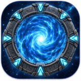

# Gatefall

Long ago a ship crashed on Earth by accident. It carried a gate, and a datachip in the wreck held three addresses. Earth was never meant to be found, and the Dominion don't know it exists. Yet.

**Build the base.** Dig rooms out of the rock, power them and staff them. Scientists study what your teams bring home, engineers turn it into weapons, armour and probes, and every room costs upkeep. Keep the books balanced or the base starves.

**Step into the unknown.** A probe sent through the gate might pick up movement, a structure or an energy signature. It won't tell you what's waiting. Your team finds that out when they walk out on the other side: a settlement, a garrison or an empty ruin. Fight, or slip back through the gate. Linger too long on a quiet world and the gate opens behind you.

**Fight smart.** Cover, flanking and overwatch. The enemy take cover too, pick off the wounded and lob grenades at a squad that bunches up. Walk into their line of sight and they may react before you finish moving. Recruit fighters from allied worlds, each with their own gear and skills: the Warder's shield bash and charge, the Hunter's poisoned arrows, the Seer's foresight.

**Chart the stars.** Every world you reach and every glyph fragment you recover sharpens your star chart. Piece together addresses nobody gave you, and the network opens up one world at a time.

**Stay hidden.** Every time the Dominion catch you, they get a little closer to finding Earth.

## Download

Download the launcher for your computer. It installs the game, keeps both the game and itself up to date, and still starts the game when you are offline. You only ever download it once.

| Computer | Launcher |
|---|---|
| Steam Deck and Linux (x86-64) | [Gatefall-Launcher-linux-x86_64](https://github.com/dripster82/gatefall-releases/releases/latest/download/Gatefall-Launcher-linux-x86_64) |
| Windows (64-bit) | [Gatefall-Launcher-windows-x64.exe](https://github.com/dripster82/gatefall-releases/releases/latest/download/Gatefall-Launcher-windows-x64.exe) |
| Mac (Apple silicon) | [Gatefall-Launcher-macos-arm64.dmg](https://github.com/dripster82/gatefall-releases/releases/latest/download/Gatefall-Launcher-macos-arm64.dmg) |

All versions are on the [Releases](https://github.com/dripster82/gatefall-releases/releases) page. Intel Mac builds are not available yet.

There is nothing else to install: the launcher brings its own Python and everything the game needs.

> **Already have a launcher from before?** Versions before 1.0.5 cannot update themselves. Download it once more from the
> table above and replace the one you have — from then on it looks after itself.

## Steam Deck

1. Hold the power button and choose **Switch to Desktop**.
2. Download the Linux launcher (above) with the browser. It lands in **Downloads**.
3. In the file manager, right-click the launcher → **Properties** → **Permissions** → tick **Is executable** → **OK**.
4. Double-click it. The first start downloads the game, so be online for it. When the launcher's menu appears,
   choose **Exit**.
5. A **Gatefall** icon is now on the Desktop, and Gatefall is in the app menu. Right-click the Gatefall icon →
   **Add to Steam**. (No icon? Start the launcher, open **Settings** → **Create Desktop shortcut**.)
6. Double-click the Gatefall icon and choose **Exit** again. This lets the launcher give its Steam library entry the
   Gatefall artwork.
7. Go back to Game Mode (the **Return to Gaming Mode** icon on the desktop). Gatefall is in your Library with its
   artwork; if it still shows a grey tile, restart Steam.
8. In your Library, open Gatefall → the controller icon → pick the **Keyboard and Mouse** template. The trackpad moves
   the pointer and the triggers click.
9. Play. In the game, open **Settings** and turn on **Fullscreen**.

The launcher leaves the Deck's built-in controls to Steam, so the trackpad pointer keeps working in both the launcher and the game.

## Linux

Download the launcher, make it executable (`chmod +x Gatefall-Launcher-linux-x86_64`) and run it. It adds Gatefall,
with its icon, to your app menu and puts a Gatefall icon on the Desktop. Delete that icon if you don't want it; it
stays deleted, and the launcher's **Settings** → **Create Desktop shortcut** brings it back. To play
through Steam, add that icon to Steam as a non-Steam game, as above, and start it once more so the launcher can give
it its library artwork.

## Windows

Put the launcher somewhere you'll keep it (the Desktop is fine) and run it. The launcher isn't signed yet, so the first time Windows may say it protected your PC: click **More info**, then **Run anyway**. You should only see that once, because the launcher updates itself in place rather than asking you to download a new one.

## Mac

Open the dmg and drag **Gatefall** into **Applications**, then start it from there. The launcher and the game are signed and notarized by Apple.

## Updates

- When a new version of the game is out, the launcher **asks**: press **Enter** or click to update, or **Esc** to play the version you already have. On a controller that is **A** and **B**.
- While a download runs, the screen names both versions and shows how far along it is. **Esc** stops it and starts the game you have.
- The previous version is kept on disk, so a new one with a problem is not the end of it.
- The launcher keeps **itself** up to date without asking. That update is a few tens of kilobytes and happens before the window appears, so you should never notice it, and you will not have to download the launcher again by hand.
- Offline, it simply starts the version you have. It only shows an error when there is no game installed at all.

## Saves, and removing the game

- Saves and settings are kept apart from the game files and are never touched by an update: `~/.local/share/gatefall/` on Linux, the Steam Deck and the Mac, and `%APPDATA%\Gatefall\` on Windows.
- Inside that folder, `game/` holds the game itself and `launcher/` holds the launcher's own files. Your saves are not in either.
- To remove the game, delete the launcher you downloaded and those two folders. Delete the whole Gatefall folder to remove your saves as well.

## Status

Early and in active development. Expect balance changes between versions.
